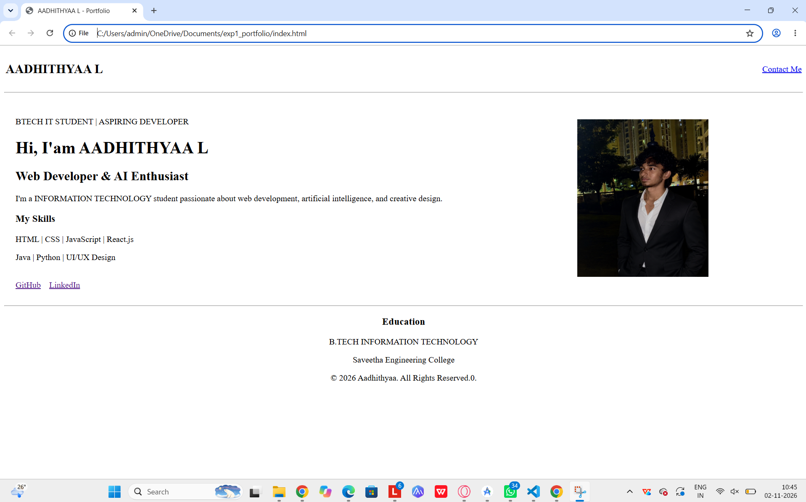

## Ex01 Portfolio
## Date: 30-10-2026
## Name : AADHITHYAA L 
## Register No: 212224220003

## AIM
To create a Portfolio using HTML and CSS.

## ALGORITHM

STEP 1
Create an HTML file (index.html)

STEP 2
Create a CSS file (style.css)

STEP 3
Include a navigation bar with links to different sections.

STEP 4
Add structured sections for introduction, about, projects, and contact details.

STEP 5
Define global styles for fonts, colors, and layout.

STEP 6
Style the header, navigation bar, and sections.

STEP 7
Use Flexbox or CSS Grid for layout design.

STEP 8
Add hover effects and transitions for interactivity.

STEP 9
Add Images and Media.

STEP 10
Use optimized images for a professional look.

STEP 11
Open the HTML file in a browser to check layout and functionality.

STEP 12
Fix styling issues and refine content placement.

STEP 13
Deploy the Portfolio.

STEP 14
Upload to GitHub Pages for free hosting.

## PROGRAM

```html
<!DOCTYPE html>
<html lang="en">
<head>
    <meta charset="UTF-8">
    <meta name="viewport" content="width=device-width, initial-scale=1.0">
    <title>AADHITHYAA L - Portfolio</title>
</head>
<body>

    <table width="100%" height="100%">
        <tr>
            <td>
                <h2>AADHITHYAA L</h2>
            </td>
            <td align="right">
                <a href="mailto:yourmail@example.com">Contact Me</a>
            </td>
        </tr>
    </table>

    <hr>

    <table width="100%" cellpadding="20">
        <tr>
            <td width="60%" valign="middle">
                <p>BTECH IT STUDENT | ASPIRING DEVELOPER</p>

                <h1>Hi, I'am AADHITHYAA L</h1>

                <h2>Web Developer & AI Enthusiast</h2>

                <p>
                    I'm a INFORMATION TECHNOLOGY student
                    passionate about web development, artificial
                    intelligence, and creative design.
                </p>

                <h3>My Skills</h3>

                <p>HTML | CSS | JavaScript | React.js</p>
                <p>Java | Python | UI/UX Design</p>

                <br>

                <a href="https://github.com/Aadhithyapranav">GitHub</a>
                &nbsp;&nbsp;
                <a href="https://www.linkedin.com/in/aadhithyaa">LinkedIn</a>
            </td>

            <td width="40%" align="center">
                
            </td>
        </tr>
    </table>

    <hr>

    <center>
        <h3>Education</h3>
        <p>B.TECH INFORMATION TECHNOLOGY</p>
        <p>Saveetha Engineering College</p>

        <p>
            &copy; 2026 Aadhithyaa. All Rights Reserved.0.
        </p>
    </center>

</body>
</html>
```
## OUTPUT




## RESULT
The program for creating Portfolio using HTML and CSS is executed successfully.